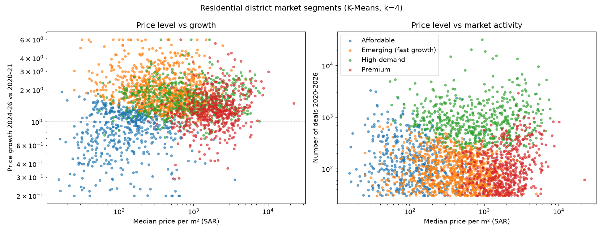
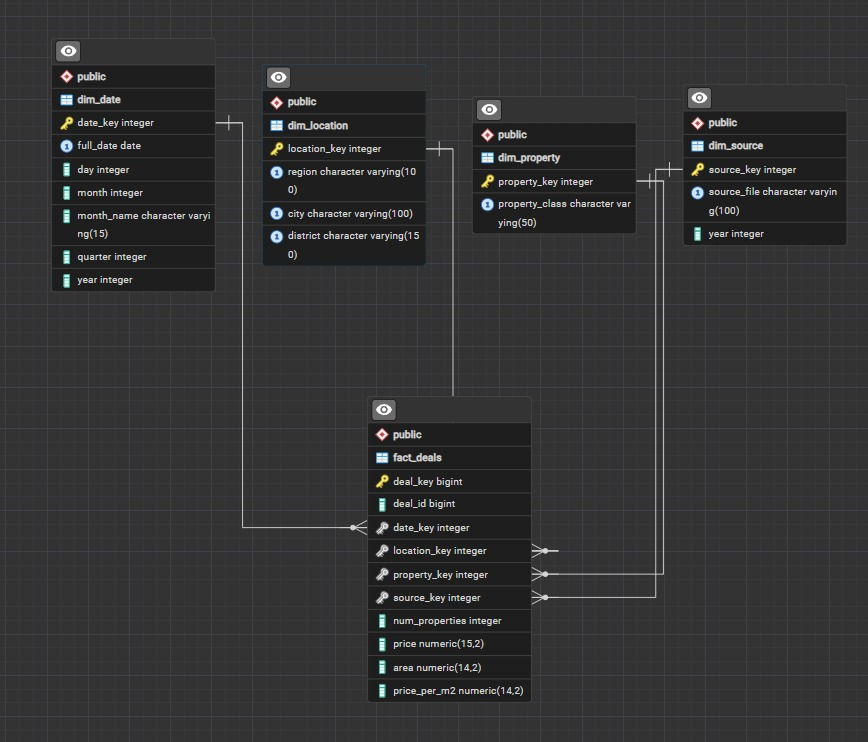
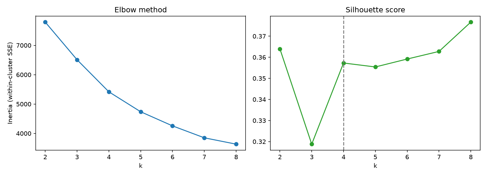

# Saudi Real Estate Data Warehouse

A data warehouse and data mining project built on **1.44 million real estate transactions** published by the
Saudi Ministry of Justice (2020 Q1 to 2026 Q1).

Raw quarterly CSV files are extracted, cleaned and loaded with **PySpark** into a **PostgreSQL star schema**,
analysed with OLAP queries, and residential districts are grouped into market segments with **K-Means clustering**
(Spark MLlib).



## Highlights

- **ETL with PySpark**: reads 25 files in 3 different column layouts, stages them in PostgreSQL, then cleans and validates them.
- **Star schema**: one fact table with 4 dimensions (date, location, property, source).
- **OLAP**: roll-up, drill-down, slice, dice, ranking and `CUBE` queries.
- **Data quality**: staged vs loaded reconciliation, invalid values, orphan keys, duplicates and outliers.
- **Data mining**: K-Means segmentation of 2,532 residential districts. k is picked with the elbow method and the silhouette score.

## Architecture

```
 MOJ CSV files ──► PySpark (extract) ──► stg_deals ──► PySpark (clean + validate) ──► star schema ──► SQL / OLAP
  (25 quarters)                         (staging)                                       │
                                                                                         └──► K-Means ──► district_segment
```

### Star schema

| Table | Grain / content | Key columns |
|---|---|---|
| `fact_deals` | one row per transaction | `price`, `area`, `price_per_m2`, `num_properties` |
| `dim_date` | one row per calendar day | day, month, quarter, year |
| `dim_location` | region > city > district | region, city, district |
| `dim_property` | property class | residential (سكني), commercial (تجاري), ... |
| `dim_source` | source file (lineage) | file name, year, quarter |
| `district_segment` | one row per clustered district | segment, median price per m², growth |



## Results

| | Q1 warehouse (notebook 01) | Full warehouse (notebook 02) |
|---|---|---|
| Source files | 7 (Q1 of each year) | 25 (every quarter) |
| Rows staged | 446,356 | 1,439,719 |
| Rows loaded | 446,352 | 1,439,705 |
| Rejected | 4 | 14 |
| Districts (`dim_location`) | 11,034 | 15,440 |

### Market segments (k = 4)

Each residential district with enough history is described by its median price per m², number of deals,
median plot area and price growth (median price per m² in 2024-2026 compared with 2020-2021).

| Segment | Districts | Median price / m² (SAR) | Median deals | Median area (m²) | Median growth |
|---|---:|---:|---:|---:|---:|
| Affordable | 512 | 120 | 114 | 612 | 0.90× |
| Emerging (fast growth) | 896 | 422 | 83 | 600 | 1.86× |
| High-demand | 554 | 782 | 832 | 495 | 1.63× |
| Premium | 570 | 1,917 | 91 | 321 | 1.26× |



An interactive version of the segment chart is in [`docs/district_segments_chart.html`](docs/district_segments_chart.html)
(download it and open it in a browser).

## Repository structure

```
├── notebooks/
│   ├── 01_q1_warehouse_etl.ipynb       ETL for the 7 Q1 files
│   └── 02_full_warehouse_kmeans.ipynb  ETL for all 25 files + K-Means segmentation
├── sql/
│   ├── create_schema.sql               star schema DDL
│   ├── olap_queries.sql                analysis, OLAP and data quality queries
│   └── segment_queries.sql             queries on the market segments
├── data/                               source CSV files (not committed, see data/README.md)
├── jars/                               PostgreSQL JDBC driver (not committed, see jars/README.md)
└── docs/
    ├── images/                         charts
    └── screenshots/                    query results and pgAdmin screenshots
```

## Getting started

### Requirements

- Python 3.12
- Java 17 or newer (needed by Spark)
- PostgreSQL 15 or newer

### Setup

```bash
# 1. Install the Python packages
python -m venv .venv
.venv\Scripts\activate          # Windows  (macOS/Linux: source .venv/bin/activate)
pip install -r requirements.txt

# 2. Download the PostgreSQL JDBC driver into jars/   (see jars/README.md)
# 3. Download the source CSV files into data/          (see data/README.md)

# 4. Create the database and the tables
createdb -U postgres DW
psql -U postgres -d DW -f sql/create_schema.sql
```

### Run

1. Open `notebooks/01_q1_warehouse_etl.ipynb` or `notebooks/02_full_warehouse_kmeans.ipynb` and run all cells.
   The notebooks ask for the Postgres password, or read it from the `PG_PASSWORD` environment variable.
   `PG_URL` and `PG_USER` can also be set if your database is not `jdbc:postgresql://localhost:5432/DW` with user `postgres`.
2. Run the queries in `sql/olap_queries.sql` (and `sql/segment_queries.sql` after notebook 02) in pgAdmin or `psql`.

Both notebooks append to the same tables, so run `sql/create_schema.sql` again before switching from one to the other.

## Data source

Real Estate Sales Transactions (الصفقات العقارية), Saudi Ministry of Justice, published on the
[Saudi National Open Data Portal](https://open.data.gov.sa) under the KSA Open Data License.
